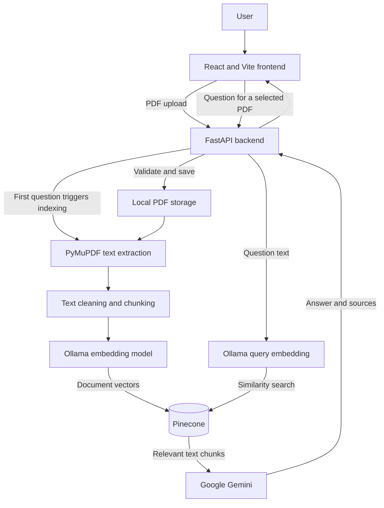

# OmniBrain

OmniBrain is a web app for asking questions about information in PDF documents. Upload PDFs, ask a question in the chat, and receive an answer grounded in the document text, with source passages and page references where available.

The app accepts up to **5 PDFs in one upload**. This limit applies to each upload request, not to the total number of PDFs in a conversation.

## Key features

- Upload and manage PDF documents, with a 20 MB limit per file.
- Extract and index PDF text when a document is first queried.
- Search document content using vector similarity.
- Ask questions about one PDF or select several PDFs. For several PDFs, the frontend requests an answer from each separately and combines the results.
- View answers with supporting source text and page references.
- Keep chat conversations and theme preferences in the browser's local storage.

## Architecture

Uploading a PDF saves and validates it on the backend. The more expensive indexing steps happen when the PDF is first queried: OmniBrain extracts text, splits it into chunks, embeds the chunks, and stores them in Pinecone. For each question, it embeds the query, retrieves relevant chunks, and sends that context to Gemini to generate an answer.

1. The React frontend sends PDF files to the FastAPI backend.
2. The backend validates and saves each PDF on the local filesystem.
3. On the first question about a PDF, PyMuPDF extracts its embedded text and page numbers.
4. The backend cleans the text and splits it into overlapping chunks.
5. Ollama creates chunk embeddings, which are stored in Pinecone.
6. For a question, Ollama creates a query embedding and Pinecone returns matching chunks.
7. Google Gemini generates an answer from the retrieved text.
8. The backend returns the answer and source details to the frontend.



Document metadata generation tries Gemini first, then the local Ollama model `llama3.2:1b`, and finally a deterministic fallback. The `llama3.2:1b` model is **not** the question-answering model.

## Technology stack

| Area | Technologies in the current implementation |
|---|---|
| Frontend | React 18, JavaScript, Vite 6, CSS |
| Frontend libraries | Lucide React, React Markdown, KaTeX, Remark GFM, Remark Math, Rehype KaTeX |
| Backend | Python, FastAPI, Uvicorn, Pydantic |
| AI and LLM | Google Gemini through `google-genai` for answers; Ollama for embeddings and an optional local metadata fallback |
| Embedding model | `nomic-embed-text-v2-moe` (Ollama) |
| Document processing | PyMuPDF for PDF text extraction; LangChain text splitters and `tiktoken` for chunking and token counting |
| Vector database | Pinecone, using a cosine-distance index |
| Configuration | `python-dotenv` and environment variables |

The answer model is selected with `GEMINI_MODEL`. The source currently has different fallback names (`gemini-3.5-flash` in `Backend/app/config.py` and `gemini-3.8-flash` in `Backend/app/services/answer_generator.py`), so configure `GEMINI_MODEL` explicitly rather than relying on a default. The intended `llama3.2:1b` model is only used as a metadata-generation fallback.

## Local development URLs

| Component | URL | Purpose |
|---|---|---|
| Frontend | `http://localhost:5173` | OmniBrain user interface (Vite's default port) |
| Backend | `http://127.0.0.1:8000` | FastAPI backend |
| API documentation | `http://127.0.0.1:8000/docs` | Interactive Swagger UI |
| Alternative API documentation | `http://127.0.0.1:8000/redoc` | ReDoc API reference |
| Health check | `http://127.0.0.1:8000/health` | Checks whether the API process is responding |

These are local development addresses, not public deployment URLs. If port 5173 is occupied, Vite may start on a different port and print that address in the terminal.

## Important services and links

| Service | URL | Purpose |
|---|---|---|
| OmniBrain repository | [github.com/SamadhanEkad/OmniBrain](https://github.com/SamadhanEkad/OmniBrain) | Source repository, verified from the Git remote |
| Ollama | [ollama.com](https://ollama.com/) | Runs the local embedding model and optional metadata fallback |
| Ollama API documentation | [docs.ollama.com](https://docs.ollama.com/) | Ollama installation and API reference |
| Pinecone | [pinecone.io](https://www.pinecone.io/) | Hosted vector database used to store and search document embeddings |
| Pinecone documentation | [docs.pinecone.io](https://docs.pinecone.io/) | Pinecone index and API reference |
| Google Gemini API | [ai.google.dev/gemini-api/docs](https://ai.google.dev/gemini-api/docs) | Cloud API used to generate answers |

Ollama's default local API address is `http://localhost:11434`. Pinecone is a cloud service; the configured index defaults to `omnibrain-documents` in AWS `us-east-1`.

## Project structure

```text
OmniBrain/
├── Backend/
│   ├── app/
│   │   ├── api/                 # PDF upload, deletion, and question routes
│   │   ├── services/            # PDF processing, embeddings, retrieval, and answers
│   │   ├── config.py            # Backend settings and data paths
│   │   └── main.py              # FastAPI application
│   ├── Data/
│   │   ├── raw/                 # Uploaded PDFs and document information
│   │   └── processed/           # Extracted text, chunks, and embeddings
│   ├── tests/                   # Backend tests
│   └── requirements.txt         # Python dependencies
├── Frontend/
│   ├── src/
│   │   ├── components/          # Chat, upload, document, and history UI
│   │   ├── services/            # Backend API client and request helpers
│   │   ├── App.jsx              # Main application
│   │   └── index.css            # Application styles
│   ├── package.json             # Frontend dependencies and scripts
│   ├── package-lock.json        # Locked frontend dependency versions
│   └── vite.config.js           # Vite configuration
└── .gitignore
```

## Prerequisites

- Python 3.10 or later. The source uses Python syntax introduced in 3.10; no upper supported version is declared.
- Node.js 18.x, 20.x, or 22+ and npm (the frontend uses Vite 6).
- [Ollama](https://ollama.com/) running locally, with the embedding model `nomic-embed-text-v2-moe` available.
- A Pinecone account and API key.
- A Google Gemini API key for answer generation.

The local `llama3.2:1b` model is optional: it is used only if Gemini-based metadata generation is unavailable. OmniBrain can also use deterministic metadata as a final fallback.

## Installation and setup

### 1. Clone the repository

```powershell
git clone https://github.com/SamadhanEkad/OmniBrain.git
cd OmniBrain
```

### 2. Set up the backend

```powershell
cd Backend
python -m venv .venv
.\.venv\Scripts\Activate.ps1
python -m pip install -r requirements.txt
```

If PowerShell prevents virtual-environment activation, use the environment's Python executable directly: `.\.venv\Scripts\python.exe`.

### 3. Configure AI and database services

Start Ollama using the installed Ollama application or its normal service command, then download the embedding model:

```powershell
ollama pull nomic-embed-text-v2-moe
```

To enable the optional local metadata fallback as well:

```powershell
ollama pull llama3.2:1b
```

Set the Pinecone and Gemini credentials in the same PowerShell session that will run the backend. Replace the placeholders locally; do not commit real credentials:

```powershell
$env:PINECONE_API_KEY = "<your-pinecone-api-key>"
$env:GEMINI_API_KEY = "<your-gemini-api-key>"
$env:GEMINI_MODEL = "<available-gemini-model>"
```

The code creates the Pinecone index if it does not exist. Its defaults are index `omnibrain-documents`, AWS cloud, region `us-east-1`, and 768 vector dimensions. The embedding model, vector size, and Pinecone index dimensions must agree.

The backend loads configuration from environment variables and, when present, `Backend/.env` (via `python-dotenv`). It does not require a committed `.env` file.

### 4. Start the backend

From the `Backend` directory, with the virtual environment active and required environment variables set:

```powershell
python -m uvicorn app.main:app --reload --host 127.0.0.1 --port 8000
```

### 5. Start the frontend

Open another terminal:

```powershell
cd OmniBrain\Frontend
npm ci
npm run dev
```

The frontend uses `VITE_API_BASE_URL` to select the backend address; it defaults to `http://127.0.0.1:8000`. Set that variable before starting Vite only if the backend is at a different address.

### 6. Open OmniBrain

Open the frontend URL printed by Vite (normally `http://localhost:5173`). Attach one or more PDFs, upload them, and ask a question. The first question about a PDF may take longer because the backend extracts, chunks, embeds, and indexes it before answering.

## Main features

- **PDF uploads:** Upload up to five PDFs in one request. Each file must be a readable, unencrypted PDF no larger than 20 MB.
- **Text extraction and indexing:** PyMuPDF extracts page text; the backend cleans and chunks it, then creates embeddings and stores them in Pinecone when first needed.
- **Document question answering:** Ask about a selected PDF. The backend retrieves matching passages and uses Gemini to generate the response.
- **Multiple selected PDFs:** The interface sends a separate question request for each selected PDF and combines successful answers under their file names. It is not a single joint retrieval request.
- **Sources and page references:** Responses include retrieved text and available document, chunk, page, and similarity-score information.
- **Chat history:** Conversations and theme preference are stored in browser local storage.
- **Document removal:** The API removes the uploaded PDF and its local information file. The current deletion route does not invoke Pinecone vector cleanup.

## API endpoints

| Method | Endpoint | Purpose |
|---|---|---|
| `GET` | `/` | Returns basic API status and version information |
| `GET` | `/health` | Checks that the API process is responding; it does not check AI or database services |
| `POST` | `/api/documents/upload` | Accepts multipart form data with one or more files under the repeated `files` field; returns `uploaded` and `failed` lists |
| `DELETE` | `/api/documents/{document_id}` | Removes a document's local PDF and information file |
| `POST` | `/api/documents/{document_id}/answer` | Accepts JSON `{"question": "..."}` and returns an `answer` and `sources` list |

The question must contain 1–2000 characters. Each source may include `document_id`, `chunk_id`, `page_number`, `score`, and `text`. The interactive API reference is available at `/docs` while the backend is running.

## Configuration and environment variables

| Variable | Purpose | Default / requirement |
|---|---|---|
| `PINECONE_API_KEY` | Authenticates with Pinecone | Required for indexing and retrieval |
| `PINECONE_INDEX_NAME` | Pinecone index name | `omnibrain-documents` |
| `PINECONE_CLOUD` | Cloud used when creating the index | `aws` |
| `PINECONE_REGION` | Region used when creating the index | `us-east-1` |
| `GEMINI_API_KEY` | Authenticates Gemini answer generation | Required for generated answers |
| `GEMINI_MODEL` | Gemini model name | Set explicitly; source fallback defaults currently differ |
| `OLLAMA_URL` | Ollama API base address for query embeddings and metadata fallback | `http://localhost:11434` |
| `EMBEDDING_MODEL` | Ollama model used to embed question text | `nomic-embed-text-v2-moe` |
| `OLLAMA_LLM_MODEL` | Local Ollama model used as a metadata fallback | `llama3.2:1b` |
| `VECTOR_SIZE` | Expected Pinecone and embedding vector dimension | `768` |
| `MAX_FILES_PER_UPLOAD` | Maximum PDFs in one upload request | `5` |
| `MAX_UPLOAD_SIZE_BYTES` | Maximum size of each PDF | `20971520` bytes (20 MiB) |
| `CORS_ORIGINS` | Comma-separated allowed frontend origins | Localhost origins, including Vite's default port |
| `LOG_LEVEL` | Backend log level | `INFO` |
| `VITE_API_BASE_URL` | Backend base URL used by the frontend | `http://127.0.0.1:8000` |

Backend variables are read from the process environment and `Backend/.env` when present. The frontend reads `VITE_API_BASE_URL` from its Vite environment; `Frontend/.env.example` shows the default. Do not put credentials in source control.

## Limitations

- PDF extraction reads embedded text only. Scanned PDFs without selectable text are rejected; OCR and visual chart/table analysis are not implemented.
- Upload limits are five PDFs per request and 20 MiB per file. The limit is per request, not a total conversation cap.
- The first question about a PDF performs indexing and may take longer than subsequent questions.
- Retrieval and generated answers can be incomplete or incorrect; check cited source passages against the original PDF.
- Questions across several selected PDFs are handled as separate per-document requests and combined in the frontend.
- Deleting a PDF removes its local files, but the current API route does not delete that document's Pinecone vectors.

## Troubleshooting

- **Backend does not start:** Confirm Python 3.10+ is selected, activate the virtual environment, and install `Backend/requirements.txt`.
- **Frontend dependencies are missing:** Run `npm ci` from `Frontend/`, then start it with `npm run dev`.
- **Frontend cannot reach the backend:** Start the backend on port 8000, check that `VITE_API_BASE_URL` points to it, and restart Vite after changing its environment. The backend allows local development origins by default.
- **Question answering fails:** Check `GEMINI_API_KEY` and `GEMINI_MODEL`, and verify that the configured Gemini model is available to the API key.
- **Embedding or indexing fails:** Make sure Ollama is running and `nomic-embed-text-v2-moe` is installed. Check that `PINECONE_API_KEY` is valid and the index dimension matches `VECTOR_SIZE` (768 by default).
- **PDF upload or extraction fails:** Check that the file is a valid, unencrypted PDF under 20 MiB and contains selectable text. Scanned PDFs need OCR, which is not currently provided.

## Future scope

Potential future improvements, not currently implemented, include OCR for scanned PDFs, visual analysis of charts and tables, joint retrieval across multiple PDFs, and cleanup of a document's Pinecone vectors when it is deleted.

## Author and license

The GitHub repository is owned by [SamadhanEkad](https://github.com/SamadhanEkad). No license file is present in the repository, so the project's license terms are not specified here.
