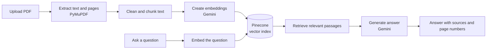

<div align="center">

# 🧠 OmniBrain

### Ask questions about your PDFs and get answers backed by cited sources.

[](https://omnibrain-frontend-be3o.onrender.com)
[](https://omnibrain-backend-1tdn.onrender.com/docs)


</div>

---

## 🌐 Live Links

| | Link |
|---|---|
| **Web application** | https://omnibrain-frontend-be3o.onrender.com |
| **API documentation (Swagger)** | https://omnibrain-backend-1tdn.onrender.com/docs |
| **API health check** | https://omnibrain-backend-1tdn.onrender.com/health |
| **Source code** | https://github.com/SamadhanEkad/OmniBrain |

> **Note:** The app runs on a free hosting plan. After a period of inactivity the server goes to sleep, so the first request can take up to a minute. Wait for the **Online** badge in the top-right corner before uploading.

---

## 📖 About

**OmniBrain** is a document intelligence app. Upload one or more PDFs, ask questions in plain language, and receive answers that are generated **only from the content of your documents**. Every answer includes the source passages and page numbers it was based on, so you can verify it.

It is built on a **Retrieval-Augmented Generation (RAG)** pipeline: documents are split into passages, converted into vector embeddings, and stored in a vector database. When you ask a question, the most relevant passages are retrieved and passed to a large language model to write a grounded answer.

## ✨ Features

- **Chat with your PDFs:** ask natural-language questions and get clear, formatted answers.
- **Cited sources:** every answer lists the document and page it came from.
- **Multi-document questions:** select several PDFs and ask one question across all of them.
- **Fast semantic search:** retrieval uses vector similarity, not keyword matching.
- **Document management:** upload up to 5 PDFs at a time (20 MB each) and delete them whenever you want.
- **Persistent chat history:** conversations and theme preference are saved in your browser.
- **Light and dark mode.**
- **Built-in health and readiness checks** for reliable operation.

## ⚙️ How It Works



1. **Upload:** the backend validates the PDF and extracts its text page by page.
2. **Index:** the text is cleaned, split into overlapping chunks, embedded with `gemini-embedding-001` (768 dimensions) and stored in Pinecone.
3. **Ask:** your question is embedded with the same model, and Pinecone returns the most similar passages.
4. **Answer:** Gemini writes a response using only the retrieved passages and returns it with citations.

## 🧰 Tech Stack

| Layer | Technology |
|---|---|
| Frontend | React 18, Vite 6, CSS, React Markdown, KaTeX, Lucide icons |
| Backend | Python 3.12, FastAPI, Uvicorn, Pydantic |
| LLM and embeddings | Google Gemini (`google-genai`): answer generation and `gemini-embedding-001` |
| Vector database | Pinecone (cosine similarity, 768 dimensions) |
| Document processing | PyMuPDF, LangChain text splitters, tiktoken |
| Hosting | Render (Web Service for the API, Static Site for the frontend) |
| Testing | pytest (backend), Vitest (frontend) |

## 📁 Project Structure

```text
OmniBrain/
├── Backend/
│   ├── app/
│   │   ├── api/            # Upload, delete and question routes
│   │   ├── services/       # PDF processing, embeddings, retrieval, answers
│   │   ├── config.py       # Settings and environment variables
│   │   └── main.py         # FastAPI app, CORS, health and readiness checks
│   ├── tests/              # Backend tests
│   ├── requirements.txt
│   └── .env.example
├── Frontend/
│   ├── src/                # React application
│   ├── tests/              # Frontend tests
│   └── package.json
├── scripts/                # Deployment check tool
├── render.yaml             # Render blueprint
├── DEPLOY.md               # Deployment guide
└── README.md
```

## 🚀 Run Locally

### Prerequisites

- Python 3.12 and Node.js 18+
- A [Pinecone](https://www.pinecone.io/) API key
- A [Google Gemini](https://aistudio.google.com/) API key

### 1. Clone

```bash
git clone https://github.com/SamadhanEkad/OmniBrain.git
cd OmniBrain
```

### 2. Start the backend

```powershell
cd Backend
python -m venv .venv
.\.venv\Scripts\Activate.ps1          # macOS/Linux: source .venv/bin/activate
pip install -r requirements.txt
Copy-Item .env.example .env           # macOS/Linux: cp .env.example .env
# Edit .env and add your PINECONE_API_KEY and GEMINI_API_KEY
python -m uvicorn app.main:app --reload --host 127.0.0.1 --port 8000
```

Check that it works: http://127.0.0.1:8000/health and http://127.0.0.1:8000/ready

### 3. Start the frontend

```bash
cd Frontend
npm ci
npm run dev
```

Open http://localhost:5173.

## 🔐 Configuration

Backend variables (`Backend/.env` locally, Render dashboard in production):

| Variable | Description | Default |
|---|---|---|
| `PINECONE_API_KEY` | Pinecone API key | **required** |
| `GEMINI_API_KEY` | Google Gemini API key | **required** |
| `GEMINI_MODEL` | Model used to generate answers | `gemini-3.5-flash` |
| `EMBEDDING_PROVIDER` | Embedding provider | `gemini` |
| `EMBEDDING_MODEL` | Embedding model | `gemini-embedding-001` |
| `VECTOR_SIZE` | Embedding dimensions (must match the index) | `768` |
| `PINECONE_INDEX_NAME` | Pinecone index name | `omnibrain-documents-gemini` |
| `PINECONE_CLOUD` / `PINECONE_REGION` | Used when the index is created | `aws` / `us-east-1` |
| `CORS_ORIGINS` | Allowed frontend origin(s), comma-separated | localhost in development |
| `ENVIRONMENT` | Set to `production` when deployed | `development` |
| `MAX_FILES_PER_UPLOAD` | PDFs per upload | `5` |
| `MAX_UPLOAD_SIZE_BYTES` | Max size per PDF | `20971520` (20 MB) |

Frontend variable:

| Variable | Description |
|---|---|
| `VITE_API_URL` | Base URL of the backend API (baked in at build time) |

> Never commit real API keys. `.env` files are excluded by `.gitignore`.

## 🔌 API Overview

Interactive documentation is available at `/docs`.

| Method | Endpoint | Purpose |
|---|---|---|
| `GET` | `/health` | Confirms the API is running |
| `GET` | `/ready` | Checks Gemini access, the Pinecone index and embedding generation |
| `POST` | `/api/documents/upload` | Upload one or more PDFs |
| `GET` | `/api/documents/{id}/status` | Processing status of a document |
| `POST` | `/api/documents/answer` | Ask a question over selected documents |
| `DELETE` | `/api/documents/{id}` | Delete a document and its vectors |

## ☁️ Deployment (Render)

| Service | Type | Root | Build | Start / Publish |
|---|---|---|---|---|
| `omnibrain-backend` | Web Service (Python) | `Backend` | `pip install -r requirements.txt` | `uvicorn app.main:app --host 0.0.0.0 --port $PORT` |
| `omnibrain-frontend` | Static Site | `Frontend` | `npm ci && npm run build` | publish `dist` |

Three rules for a working deployment:

1. **`VITE_API_URL` is applied at build time.** After changing it, redeploy the frontend.
2. **`CORS_ORIGINS` must exactly match the frontend URL** (`https`, no trailing slash).
3. **Set `ENVIRONMENT=production`** on the backend.

To verify a deployment:

```bash
python scripts/check_deployment.py --backend https://omnibrain-backend-1tdn.onrender.com --frontend https://omnibrain-frontend-be3o.onrender.com
```

See [DEPLOY.md](DEPLOY.md) for the full guide.

## 🧪 Testing

```bash
# Backend
cd Backend && python -m pytest -q

# Frontend
cd Frontend && npm test && npm run build
```

## ⚠️ Limitations

- **Text-based PDFs only.** Scanned documents without selectable text are not supported (no OCR yet).
- **Temporary file storage on the free plan.** Uploaded files are lost when the server restarts or redeploys, and the app will ask you to upload them again. A persistent disk on a paid plan removes this limit.
- **No user accounts.** There is no authentication or per-user isolation, so do not upload confidential documents to the public demo.
- **AI answers can be imperfect.** Always check the cited passages against the original document.
- **Free-tier API quotas** can occasionally cause temporary "busy" responses from the AI service.

## 🗺️ Roadmap

- User authentication and per-user document isolation
- OCR support for scanned PDFs
- Chart and table understanding
- Persistent document storage
- Support for additional file types

## 👤 Author

**Samadhan Ekad**
GitHub: [@SamadhanEkad](https://github.com/SamadhanEkad)

---

<div align="center">

If you find this project useful, please consider giving it a ⭐

</div>